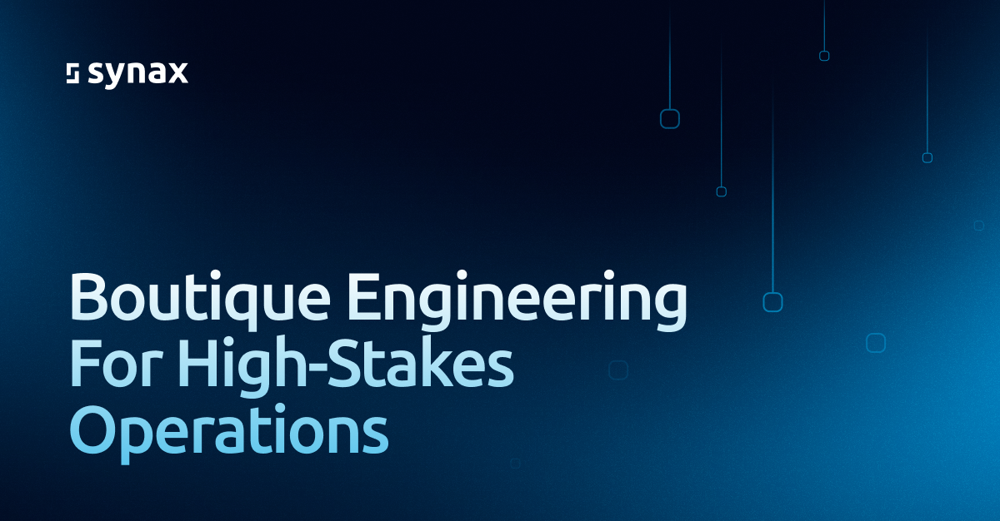
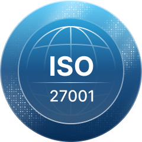
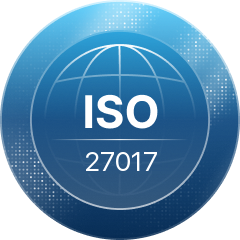
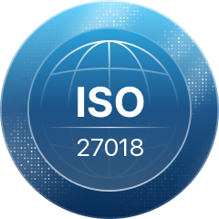
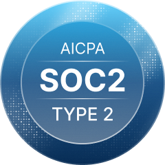

# Hi, I'm Stefan 👋

Founder and CEO of [Synax](https://synax.io), based in Basel, Switzerland. SRE by training, builder by habit, kanban at heart. I still ship to production every week.

I borrow from Toyota's shop-floor practice of *karakuri*, where the people doing the work build small mechanisms to take tedious motion off their own hands. In software, that means turning repetitive *katakata* at the keyboard into purpose-built tools and agents: less toil, steadier flow and a higher bar on what a small senior team can do.

## Synax

We are a boutique engineering team for companies whose systems can't afford to break: banking, fintech, e-commerce and industry. Since 2018 we have delivered more than 20 projects across three disciplines that turn out to be one system.

- **Reliability.** SLOs on the user journeys revenue depends on, error budgets that decide when to ship and when to fix, and incident response that hands over between Basel, New York and Japan.
- **AI that reaches production.** Most AI pilots stall in the sandbox. We build agents and automated workflows wired into real systems, with evaluation, drift detection and versioned prompts so every change can be traced and rolled back. A model can be up and still wrong; we measure for that.
- **Developer experience.** Golden paths, self-service platforms and canary rollouts an SLO can halt, so teams ship in small, safe steps.

Senior engineers only. The people who scope the work are the people who do it, and the goal is capability in the client's team, not dependency on ours.

## What I focus on

**Leading Synax**

- Setting direction: which problems we take on, which markets we serve and where the company goes next
- Shaping how the team works: senior engineers, direct client access, work pulled in small batches and decisions made in the open
- Equipping our own workflow with single-purpose agents built by the team, each scoped to one job in an environment that is secure, traceable and scales with us

**Hands-on**

- Designing multi-tenant cloud platforms that are reproducible, automated and verifiable from day one
- Shipping AI agents in regulated environments, putting deterministic guardrails and strict tool boundaries around non-deterministic models
- Building security in by design: least-privilege access and workload identity enforced across services, pipelines and agents
- Making compliance part of delivery, so the evidence exists before the auditor asks for it

Most of my code lives in the [Synax GitHub org](https://github.com/synax).

## Trust

Synax is ISO 27001, ISO 27017, ISO 27018 and SOC 2 Type 2 certified, and a member of the CNCF and the Linux Foundation.

  &nbsp;
  &nbsp;
  &nbsp;
  

## Background

15+ years in systems engineering before founding Synax: solution architect at itnetX, senior engineer at Swiss Re, Glencore and Redtoo. BSc in Computer Science (Software Engineering) from ZHAW. CKA.

## Find me

📍 Basel, Switzerland  
🌐 [synax.io](https://synax.io)  
✉️ [stefan.henseler@synax.io](mailto:stefan.henseler@synax.io)
